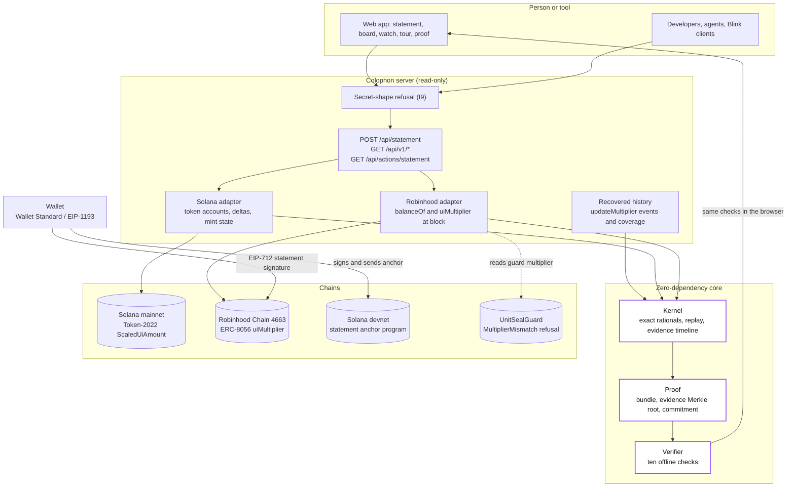
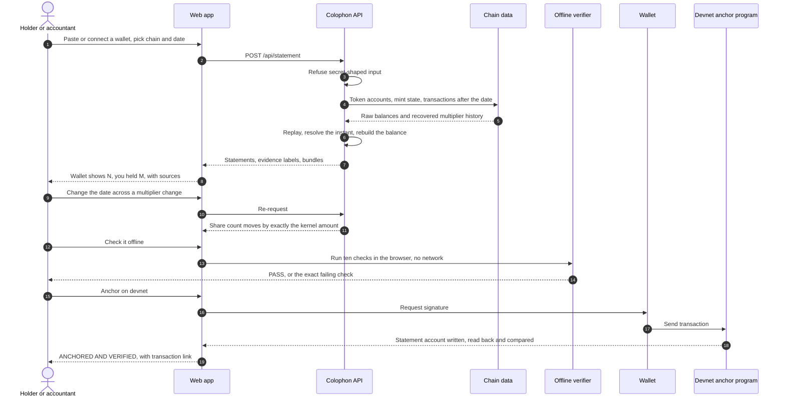
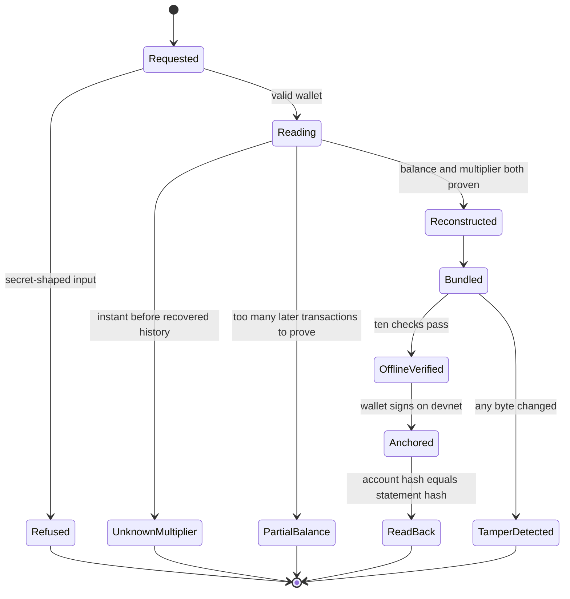
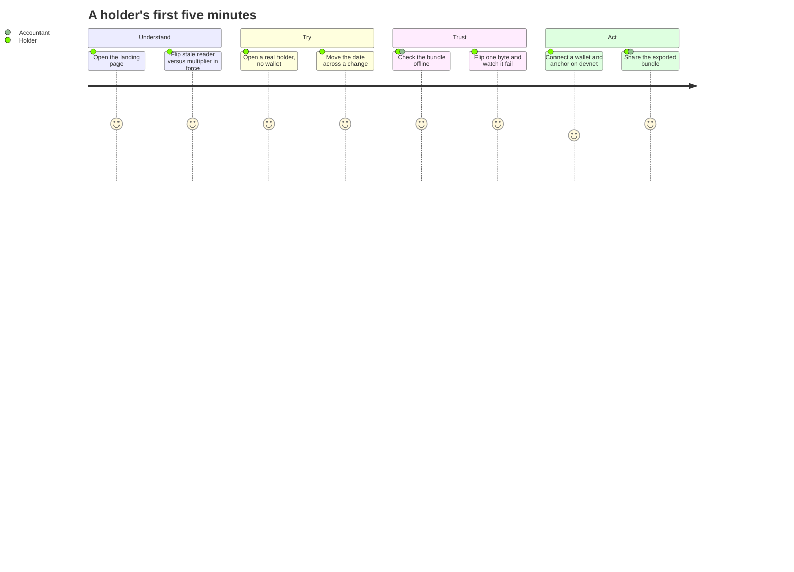
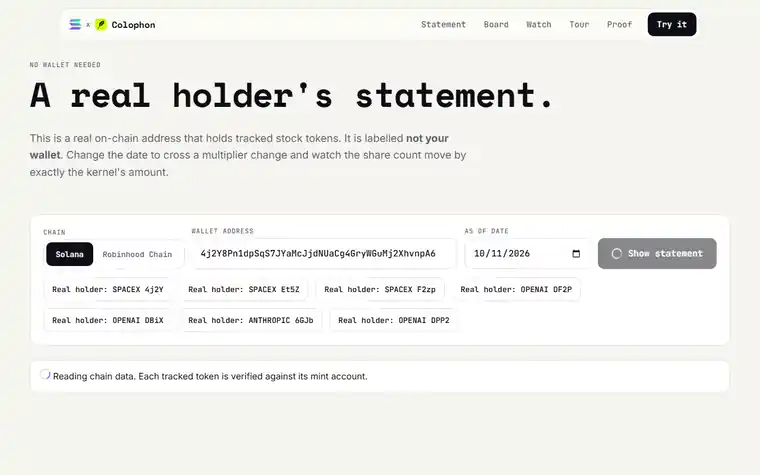
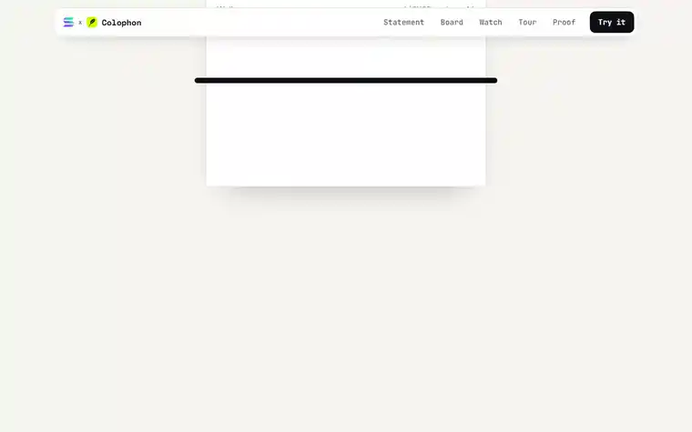
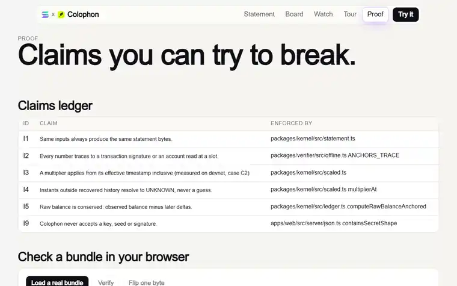

<div align="center">


&nbsp;&nbsp;<b>x</b>&nbsp;&nbsp;


# Colophon

### What you actually held, on any date, with the source behind every line.

**Verifiable ownership statements for tokenized stocks on Solana and Robinhood Chain.**<br/>
One kernel. Two chains. A bundle anyone can re-check offline, in a browser, with no network.


<br/>


</div>

<br/>

## Links

| | |
|---|---|
| **Live app** | `LIVE_APP_URL_PLACEHOLDER` |
| **Video demo (under 3 minutes)** | `VIDEO_DEMO_URL_PLACEHOLDER` |
| **No-wallet demo** | `LIVE_APP_URL_PLACEHOLDER/try` |
| **Guided tour** | `LIVE_APP_URL_PLACEHOLDER/tour` |
| **Proof, tamper results and in-browser verifier** | `LIVE_APP_URL_PLACEHOLDER/proof` |
| **Public API** | `/openapi.json`, `/llms.txt`, Solana Action at `/api/actions/statement` |
| **npm package (`@colophon/kernel`)** | `NPM_URL_PLACEHOLDER` |
| **Source** | https://github.com/0xkinno/colophon_ |
| **Tracks** | Solana ecosystem track, Robinhood Chain track, Superteam Nigeria side track |

<br/>

## Contents

1. [The one-minute version](#the-one-minute-version)
2. [The problem nobody can see](#the-problem-nobody-can-see)
3. [What we measured on chain](#what-we-measured-on-chain)
4. [How Colophon works](#how-colophon-works)
5. [Architecture](#architecture)
6. [Product flow](#product-flow)
7. [Tour of the product](#tour-of-the-product)
8. [Wallet transactions that work end to end](#wallet-transactions-that-work-end-to-end)
9. [Judging criteria, answered one by one](#judging-criteria-answered-one-by-one)
10. [Why Solana, and why Robinhood Chain](#why-solana-and-why-robinhood-chain)
11. [Evidence, including the negative results](#evidence-including-the-negative-results)
12. [Who reads these tokens wrong](#who-reads-these-tokens-wrong)
13. [Public API](#public-api)
14. [Security model](#security-model)
15. [Quality and verification](#quality-and-verification)
16. [What we got wrong, and fixed](#what-we-got-wrong-and-fixed)
17. [Limitations](#limitations)
18. [Roadmap](#roadmap)
19. [Run it yourself](#run-it-yourself)
20. [Repository map](#repository-map)
21. [Credits and license](#credits-and-license)

<br/>

## The one-minute version

A tokenized stock does not behave like a normal token. Its raw balance never moves when a corporate action happens. A **multiplier** moves instead, and the chain keeps only the current value. So the number your wallet prints is true only relative to a clock, and nobody records the clock.

Colophon makes the clock an explicit, reconstructed, verifiable input.

- **Reconstruct.** Recover the multiplier history from transactions, because state alone cannot tell you.
- **Print.** Produce a statement for any wallet and date, with the signature or account read behind every number.
- **Prove.** Pack it into a bundle that a browser re-derives with no network, and that refuses a single flipped byte.
- **Act.** Anchor the statement hash on Solana with your own wallet, or sign it on Robinhood Chain.

> **A tokenized-stock balance is only true relative to a clock. Colophon makes the clock an explicit, reconstructed, verifiable input, on Solana and on Robinhood Chain.**

| At a glance | |
|---|---|
| Tokenized stocks tracked on Solana | **111** (101 xStocks, 10 PreStocks), each proven on chain, none typed by hand |
| Tokenized stocks tracked on Robinhood Chain | **194**, read live from the chain's asset list and `uiMultiplier()` |
| Devnet semantic lab | **6 cases**, every one a real transaction with a signature |
| Tamper cases against a real bundle | **21 of 21 refused** |
| Automated tests | **53** (34 kernel and property, 19 verifier), plus a Playwright journey across both chains |
| Keys, seeds or signatures the server will accept | **0** |

<br/>

## The problem nobody can see

Tolu lives in Lagos. Last year he bought SPYx and NVDAx on Solana and some TSLA stock tokens on Robinhood Chain. His accountant asks a plain question: *what did you hold on 31 December?*

His wallets show today's numbers, adjusted by multipliers that changed since. Neither wallet can say which part of the balance was a purchase, which part was a corporate action, or what he held on that day. (Tolu is illustrative. The mechanism is not.)

<div align="center">

</div>

On a real holder of the SpaceX PreStocks token, a reader that stops at the stored `multiplier` field prints **3.085521957**. The multiplier in force gives **15.427609785**. That is a 400 percent difference on one wallet, from one field that is never rolled forward on its own.

<br/>

## What we measured on chain

Nothing below was assumed. Each row is a real devnet transaction on a Token-2022 mint with the ScaledUiAmount extension, recorded in `evidence/semantic_lab/e2_boundary_lab.json` and shown on `/lab`.

| Case | Question | Measured answer |
|---|---|---|
| **C1** | After the effective time passes, does `multiplier` roll forward by itself? | **No.** The stored field stays at the old value. `newMultiplier` is the one in force. |
| **C2** | Is the boundary `>=` or `>` at the effective timestamp? | **Inclusive.** The scaled value appears when block time equals the effective timestamp. |
| **C3** | Schedule A, then B before A takes effect. Is A recoverable from state? | **No.** State holds only B. A survives only in transaction history. |
| **C4** | Let A take effect, then schedule B. Does `multiplier` become A? | **Yes.** It rolls to the value active at submission. |
| **C5** | Large raw amount with a multiplier that is not exactly representable | Program output equals exact decimal at this size, and the kernel uses integer arithmetic regardless. |
| **C6** | What does `getTokenAccountBalance` show during the pending window? | The old value until the effective time, then the new one, computed by the program. |

**The finding that shaped the design is C3.** The chain overwrites a scheduled change that has not taken effect, so a reader that only has state can never learn that A existed. Any honest history has to come from transactions. That is why Colophon recovers `updateMultiplier` instructions from the multiplier authority's history, including inner instructions executed through a multisig, instead of trusting a snapshot.

<br/>

## How Colophon works

<div align="center">

</div>

1. **Read the holder.** Token accounts for the wallet, filtered to the verified universe, plus the live multiplier state of each mint.
2. **Recover the history.** Page the multiplier authority's signatures, fetch each transaction, and extract every Token-2022 `updateMultiplier` (outer and inner).
3. **Replay with measured rules.** Apply the devnet-pinned semantics (C1 to C4) to rebuild intervals and compare the replay with the live account. If they disagree, the timeline says so.
4. **Resolve the instant.** Pick the multiplier in force at the chosen second using exact rational arithmetic. If the instant falls outside recovered history the answer is `UNKNOWN`, never a guess.
5. **Reconstruct the balance.** Raw balance at the date is the balance observed now minus every later delta, each delta tied to a transaction.
6. **Emit a bundle.** Statement, source events, anchors, an evidence Merkle root and a commitment, all hashed deterministically.
7. **Verify anywhere.** The same ten checks run on the server, in the browser and in the break campaign.

Every number carries an evidence label.

| Label | Meaning |
|---|---|
| `MEASURED` | Read from chain at a known slot or block |
| `REPLAYED` | Derived by replaying recovered transactions |
| `SYNTHETIC` | A labelled illustration on a real mint |
| `OFFCHAIN` | From an off-chain source |
| `UNKNOWN` | Not recorded. Shown as unknown, not smoothed over |

<br/>

## Architecture



Every arrow into the core is a read. Colophon never holds a key and never signs on mainnet. The only writes in the system are made by the person's own wallet.

<br/>

## Product flow







<br/>

## Tour of the product

### A statement, with the date as an instrument

Pick any date. The share count changes by exactly the kernel's amount, and every line links to the account or transaction behind it. Digits roll instead of swapping, so a change is something you see.

<div align="center">

</div>

### The statement prints itself

A pinned scroll chapter feeds the statement out of a slot, line by line, ending in the Colophon block with the bundle hash. On the landing page it uses a real holder's data when one is recorded, and says `SYNTHETIC` when it does not.

<div align="center">

</div>

### Check it offline, then break it

The verifier runs in your browser. Load a real bundle, watch ten checks pass, then flip one byte and watch the exact check that catches it.

<div align="center">

</div>

### A board for both chains

Multiplier in force, the stored field a naive reader sees, anything already scheduled, and the issuer's powers (permanent delegate, pausable, transfer hook, transfer fee). Every Solana mint was proven on chain before it was listed, and each token shows the same icon a wallet shows.

<div align="center">

</div>

### A tour that drives the real app

Five chapters with a progress line, arrow keys, wheel and swipe. The right pane is the actual statement page in an iframe, driven by `postMessage`. Nothing in it is a mock-up.

<div align="center">

</div>

### Motion with rules

| Component | What it does | Why |
|---|---|---|
| `CapsuleNav` | Floating blurred capsule, active item glides on a spring with a purple glow | Orientation without weight |
| `HeadlineBlur` | Words resolve from blur one by one | The hero reads as it arrives |
| `CardStack` | Real multipliers on tilted cards that fan out when scrolled into view | Shows the divergence before explaining it |
| `TickerMarquee` | Edge-masked ticker of live multipliers with each token's own icon | Proves the universe is real |
| `LedgerCircuit` | SVG beams flow wallet and history into the kernel, a stale read stops and lights `REFUSED` | The whole thesis in four seconds |
| `PrintedStatement` | One scroll value drives a statement out of a slot | The product's signature moment |
| `DigitRoll` | Per-digit roll when a share count changes | Change is visible, not abrupt |
| `TwoHalvesLine` | Flat raw balance against a stepped multiplier, with the chosen date marked | A balance is two halves |
| `LiveTour` | Chapters driving the real page | Show, do not describe |

Rules the motion follows: nothing waits at zero opacity for scroll, one continuous loop per screen at most, no animation on data a person is reading in a table, and every animation has a reduced-motion final frame.

<br/>

## Wallet transactions that work end to end

| Action | Chain | Wallet | What happens | Moves funds |
|---|---|---|---|---|
| **Anchor a statement** | Solana devnet | Any Wallet Standard wallet (Phantom, Solflare, Backpack) | Derives a program-derived account from the statement hash, sends the instruction, confirms, then **reads the account back and compares the hash** | No (rent only) |
| **Request devnet SOL** | Solana devnet | Connected wallet | Faucet call so a new wallet can anchor immediately | No |
| **Record a statement hash** | Solana (Blink) | Any Action client | `POST /api/actions/statement` returns a memo transaction carrying `colophon:statement:<hash>` | No |
| **Sign a statement** | Robinhood Chain | MetaMask or any EIP-1193 wallet | EIP-712 typed data over statement hash, token, date and holder, verified locally with `verifyTypedData` | No |
| **Read the guard** | Robinhood Chain | None | Reads `getCurrentMultiplier(token)` from UnitSealGuard | No |
| **Switch or add chain** | Robinhood Chain | EIP-1193 wallet | `wallet_switchEthereumChain`, falling back to `wallet_addEthereumChain` | No |

The anchor path is exercised by `pnpm smoke` with a Wallet Standard wallet whose signing happens in Node against a real devnet key: the page builds the transaction, the wallet signs and sends it, and the page confirms the on-chain account holds the exact statement hash.

<br/>

## Judging criteria, answered one by one

### Functionality

- Real statements for any Solana wallet and any Robinhood Chain wallet, for any date, with evidence labels and links to the underlying account or transaction.
- Honest states instead of silent guesses: `UNKNOWN_MULTIPLIER`, `PARTIAL_BALANCE`, `COVERAGE: CURRENT_ONLY`.
- An offline verifier with ten checks, a break campaign of 21 attacks, 53 unit and property tests, and a Playwright journey test.
- Wallet actions that really transact (see above), not a mocked button.

### Potential impact

Every holder of tokenized equities will one day need a statement for a tax filing, an audit, a loan or an inheritance, and today none can be produced from a wallet. The market already spans two chains with two implementations of the same idea, so a tool that works on both serves the whole category. Custodians, tax software and lenders are the business case. Individuals like Tolu are the reason.

### Novelty

1. **History reconstruction.** The chain stores only the latest state, so earlier updates are recovered from transactions, including inner instructions run through a multisig.
2. **A portable statement.** One bundle that anyone re-derives offline, with an evidence Merkle root and a commitment that binds hash, evidence, mint, wallet and instant.
3. **One kernel across two chain implementations.** The kernel never imports a chain SDK.
4. **Measured program semantics.** Six devnet cases pin rules that documentation does not state, and the replay uses them.
5. **A compatibility probe.** A timestamped table of where common read paths agree and disagree with the kernel.
6. **Honesty as a feature.** `UNKNOWN` is a first-class answer, and a CI guard fails the build on any value that did not come from a chain read.

### UX

A scroll story that prints a statement, a floating capsule nav, digits that roll, a no-wallet demo that opens a real holder in one click, a tour that drives the real page, a bottom-sheet menu and a vertical circuit on mobile, keyboard and screen-reader labels throughout, and reduced-motion support.

### Open source and composability

- `@colophon/kernel` has zero dependencies and runs in Node, the browser and the edge.
- Public JSON API with open CORS and a published OpenAPI document.
- `llms.txt` so agents can discover the API.
- A Solana Action (Blink) at `/api/actions/statement`.
- MIT licensed, with `REVIEW.md` listing the five claims a reviewer should try to break.

### Business plan

| Tier | Who | What | Why they pay |
|---|---|---|---|
| **Free** | Holders | Personal statements for any wallet on both chains | Distribution and trust |
| **Pro** | Accountants, funds | Multi-wallet packs, year-end exports in tax-tool formats, signed bundles | They file for many clients |
| **API** | Wallets, tax software, lenders | Point-in-time multiplier and statement endpoints, metered | Their users ask this question daily |

The wedge is the accountant's question. The moat is the history: every update the Watch keeper records is one the chain will never serve again.

<br/>

## Why Solana, and why Robinhood Chain

**Solana.** Token-2022 puts the multiplier in the mint account itself, and every authority update is a transaction a reader can fetch, parse and replay. Program-derived accounts make an immutable per-statement commitment cheap, and Wallet Standard means any wallet can anchor it. Solana is where the history problem is hardest and the evidence is richest, so it is the primary adapter.

**Robinhood Chain.** The same economic idea arrives as ERC-8056, `uiMultiplier()` at selector `0xa60bf13d` next to an ordinary `balanceOf`. Colophon reads both at the block nearest the chosen date by archive `eth_call`, and says `COVERAGE: CURRENT_ONLY` when an endpoint will not serve archive state. The UnitSealGuard contract at `0x2518853d8a6799734ded70857f0cffc26a175c14` closes the loop: the read side tells you what you held, and the guard refuses to act on a seal bound to a stale multiplier with `MultiplierMismatch`.

<br/>

## Evidence, including the negative results

| Result | Detail |
|---|---|
| Universe | 111 Token-2022 mints carrying `scaledUiAmountConfig`, discovered then proven by `getAccountInfo(jsonParsed)`. Earlier work listed 12 mints and only 2 verified, so the registry is now generated from chain reads. |
| PreStocks history | The multiplier authority was read from its **first signature** (1,718 transactions). Two updates exist (SpaceX 5x, OpenAI 1.4861347x). Replaying them reproduces each mint's live state exactly. |
| xStocks history | The authority is a busy operations wallet. The 5,000 newest signatures were scanned, which covers roughly three days (8 to 11 October 2026) and recovered 2 updates (ORCLx). Dates before that window resolve to `UNKNOWN`. This is a published negative result, not a hidden one. An authenticated RPC key reads further back with the same script. |
| Largest-holder lookup | Not usable on the public endpoint for these mints. Featured holders came from recipients of issuer transfers in recovered transactions, then re-verified live. |
| Replay vs live state | Reproduced for every mint with recovered events (invariant I7). |
| Explorer page display | Not measured. Listed under limitations. |

Raw transaction dumps live in `docs/sources/`, the recovery run in `evidence/recovery/`, the lab in `evidence/semantic_lab/`, the probe in `evidence/compat/`, and the break campaign in `evidence/break/`.

<br/>

## Who reads these tokens wrong

Real responses, timestamped, read-only, nothing sent to any network (`evidence/compat/probe.json`).

| Read path | Token | It reports | Kernel (scaled) | Reading |
|---|---|---|---|---|
| RPC `getTokenSupply` | OPENAI, SPACEX, AAPLx, NVDAx, SPYx, TSLAx | Program-computed scaled supply | Raw supply x multiplier in force | **AGREES.** The RPC applies the active multiplier correctly, so a wallet that uses it is right. |
| Robinhood Chain `totalSupply()` | CRM | `165730987340000000000` (raw) | `165921300011547413836` (scaled) | **RAW VS SCALED.** `totalSupply()` is raw by design. Economic supply is raw x `uiMultiplier()`, so tools that print supply directly understate it. |
| Robinhood Chain `totalSupply()` | P, CIEN | Raw equals scaled | Same | AGREES (multiplier is 1) |

The takeaway is deliberately narrow: nodes compute the multiplier correctly, so the risk sits in code that reads the *stored field* or a *raw* figure directly, which is exactly what a statement must not do. Jupiter quote responses are denominated in raw units and were recorded but are not scored here, because without an independent price oracle there is nothing to compare them to.

<br/>

## Public API

All read-only, CORS open, cached 30 seconds with stale-while-revalidate.

| Endpoint | Returns |
|---|---|
| `POST /api/statement` | `{ wallet, chain, asOfTs }` to statements and bundles. Refuses secret-shaped fields. |
| `GET /api/v1/multiplier?chain=&mint=&at=` | Multiplier in force at that instant, provenance, live state, or `known:false` with the reason |
| `GET /api/v1/timeline?chain=solana&mint=` | Recovered events, intervals, replay consistency, coverage window |
| `GET /api/v1/verify?bundle=` and `POST` | Per-check verdict for a bundle |
| `GET /api/v1/board` | Universe rows for both chains |
| `GET /api/v1/watch` | Recorded updates newest first, plus live changes since the snapshot |
| `GET /api/actions/statement` | Solana Action (Blink) |
| `/openapi.json`, `/llms.txt` | Discovery |

```bash
curl -s -X POST "$APP/api/statement" \
  -H 'content-type: application/json' \
  -d '{"wallet":"<address>","chain":"solana","asOfTs":1767225599}'
```

```ts
import { parseDecimal, scaleRaw, formatUiAmount } from "@colophon/kernel";

const multiplier = parseDecimal("1.4861347");
formatUiAmount(1_000_000_000n, 9, multiplier, 9); // "1.486134700"
```

<br/>

## Security model

Colophon is read-only by construction.

| Property | How it is enforced |
|---|---|
| No key, seed or signature is ever accepted | `containsSecretShape` rejects byte arrays, 0x 32-byte hex, base58 of secret length, and fields named like secrets, with `422` |
| No invented values | `scripts/guard-no-fabrication.mjs` fails CI on any base58 literal outside generated constants |
| Server keys never reach the client | Only `NEXT_PUBLIC_*` values (devnet RPC, program id, site URL) are exposed |
| Mainnet is never written | Writes exist only on devnet (anchor) and as wallet-signed typed data |
| Tamper evidence | Ten verifier checks, evidence Merkle root, statement commitment, 21 break cases |

Details and attempts in [`SECURITY.md`](SECURITY.md) and [`docs/audits/`](docs/audits).

<br/>

## Quality and verification

| Layer | Count | Command |
|---|---|---|
| Kernel unit and property tests | 34 (property tests run 200 seeded histories each) | `pnpm test` |
| Verifier tests, tamper cases B1 to B19 | 19 | `pnpm test` |
| Break campaign on a **real** bundle | 21 | `pnpm break` |
| Journey test (landing, try, offline check, date change, devnet anchor, proof, tamper, every route, mobile overflow, console errors) | 18+ steps | `pnpm smoke` |
| No-fabrication guard | every literal | `pnpm guard` |
| Devnet semantic lab | 6 cases | `pnpm lab` |
| Compatibility probe | 9 scored rows | `pnpm probe` |

<br/>

## What we got wrong, and fixed

An earlier version of this project shipped a statement page with hard-coded multiplier events and signatures that did not exist on chain, after a recovery experiment hit an unauthenticated rate limit. Its instrument registry listed 12 mints, 2 of which were real. All of it was removed.

- A CI guard now fails the build on any base58 literal that did not come from a chain read.
- The recovery was rerun against the chain, and negative results are published as negative results.
- The break campaign then found a real hole in our own verifier: editing `statement.statementHash` alone passed. It is fixed, and the case is part of the campaign.

The full ledger is in [`docs/audits/audit-1-functionality.md`](docs/audits/audit-1-functionality.md).

<br/>

## Limitations

Stated here so nobody has to discover them.

- xStocks history is a bounded window until an authenticated RPC reads the authority's full history.
- Closed token accounts are not discovered by a wallet scan.
- Holdings with more than 90 later transactions on one account return `PARTIAL_BALANCE`.
- Robinhood Chain history depends on the endpoint serving archive state. The public endpoint rate limits aggressively, so a hosted deployment should set `ROBINHOOD_RPC_URL`.
- Statement anchoring is devnet only, by design.

Full list: [`docs/LIMITATIONS.md`](docs/LIMITATIONS.md).

<br/>

## Roadmap

| Next | Why |
|---|---|
| Authenticated RPC for the full xStocks authority history | Turns a bounded window into complete coverage |
| Scheduled Watch keeper snapshots | Records every future change the chain will not keep |
| npm release of `@colophon/kernel` | Composability for wallets and tax tools |
| Year-end export packs in tax-tool formats | The accountant tier |
| Mainnet anchoring behind an explicit opt-in | After an external review |
| Outside tester log | `docs/users.md` fills only with consented, real users |

<br/>

## Run it yourself

```bash
git clone https://github.com/0xkinno/colophon_.git
cd colophon_
pnpm install
cp .env.local.example .env.local      # add RPC URLs; keys only if you run the devnet lab
pnpm run build:packages
pnpm test
pnpm dev                               # http://localhost:3000
```

| Variable | Used for | Where |
|---|---|---|
| `SOLANA_RPC_URL` | Mainnet reads and statements. Use an authenticated URL for speed. | Server |
| `ROBINHOOD_RPC_URL` | Robinhood Chain reads. Public endpoint rate limits. | Server |
| `NEXT_PUBLIC_SOLANA_DEVNET_RPC_URL` | Wallet anchoring | Client |
| `NEXT_PUBLIC_COLOPHON_PROGRAM_ID` | Statement anchor program | Client |
| `NEXT_PUBLIC_SITE_URL`, `NEXT_PUBLIC_REPO_URL` | Metadata and tester issues | Client |
| `DEPLOYER_PRIVATE_KEY` | Devnet semantic lab and smoke test only. Never set in production. | Scripts |

Useful scripts:

```bash
pnpm run sync     # copy verified data into the web app
pnpm run guard    # fail on unverified literals
pnpm run lab      # devnet semantic lab (needs a funded devnet key)
pnpm run probe    # compatibility probe
pnpm run break    # tamper campaign against a running app
pnpm run smoke    # Playwright journey
```

<br/>

## Repository map

```
apps/web                 Next.js app: pages, motion components, API routes, wallet panels
packages/kernel          Exact arithmetic, replay, evidence timeline, statements (zero dependencies)
packages/proof           Bundle, evidence Merkle tree, commitment, lossless JSON codec
packages/verifier        Ten offline checks
packages/instruments     Verified mint constants, generated from chain reads
packages/chain           Read-only RPC client and parsers
packages/watch           Reconciliation loop
programs/colophon_anchor Solana statement anchor program
scripts                  Discovery, recovery, lab, probe, break, smoke, README recorder
evidence                 Recovery, semantic lab, compatibility probe, break results
docs                     Architecture, contributions, limitations, audits, credits, sources
```

Documents: [`docs/ARCHITECTURE.md`](docs/ARCHITECTURE.md), [`docs/CONTRIBUTIONS.md`](docs/CONTRIBUTIONS.md), [`docs/LIMITATIONS.md`](docs/LIMITATIONS.md), [`docs/EVIDENCE.md`](docs/EVIDENCE.md), [`docs/audits/`](docs/audits), [`REVIEW.md`](REVIEW.md), [`SECURITY.md`](SECURITY.md), [`docs/CREDITS.md`](docs/CREDITS.md).

<br/>

## Credits and license

Photography under the Unsplash License, token icons from each token's own metadata, the Solana logomark used per its brand guidelines, and the digit-roll technique adapted from an open component credited in [`docs/CREDITS.md`](docs/CREDITS.md).

MIT. Copyright (c) 2026 0xkinno.
