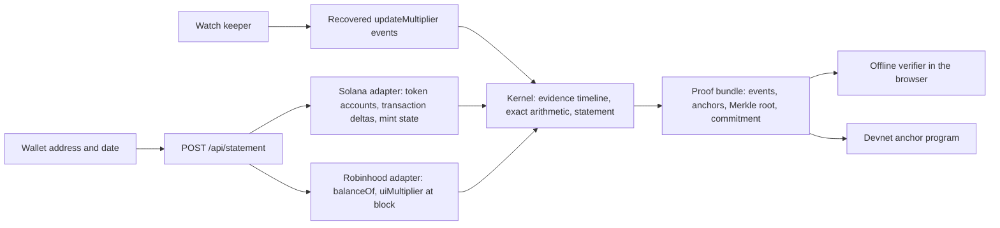

# Architecture

## Packages

| Package | Role |
|---|---|
| `@colophon/kernel` (published as `@0xkinno/kernel`) | Types, exact rational arithmetic, scaled-amount replay, statements. No dependencies. |
| `@colophon/proof` | Bundle, evidence Merkle tree, commitment, lossless JSON codec. |
| `@colophon/verifier` | Offline checks. Used by the server, the browser and the break campaign. |
| `@colophon/instruments` | Verified mint constants, generated from chain reads. |
| `@colophon/chain` | Read-only RPC client and parsers. |
| `@colophon/watch` | Reconciliation loop used by the Watch keeper. |

## Invariants

I1 determinism, I2 source traceability, I3 effective instant is inclusive, I4 nothing invented, I5 raw balance conservation, I6 monotone ordering, I7 replay agrees with live state, I8 proof determinism, I9 keys are never accepted, I10 evidence labels stay honest.

## Evidence labels

`MEASURED` read from chain at a known slot. `REPLAYED` derived by replaying recovered transactions. `SYNTHETIC` a labelled illustration on a real mint. `OFFCHAIN` from an off-chain source. `UNKNOWN` not recorded, shown as such.
